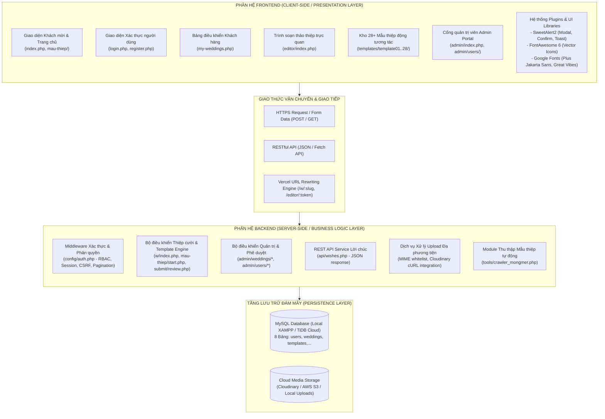
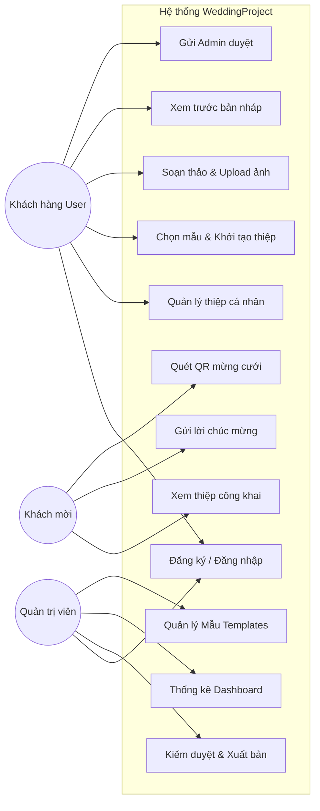
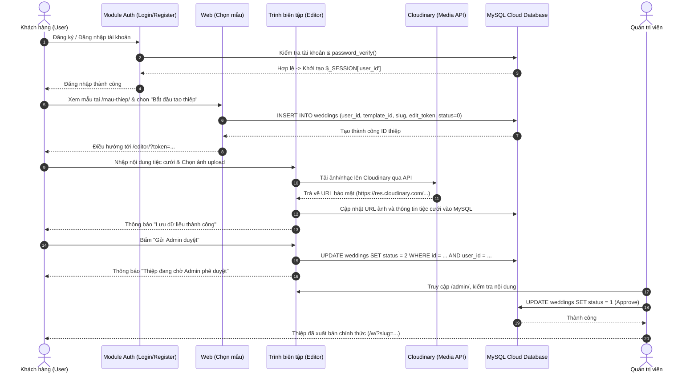
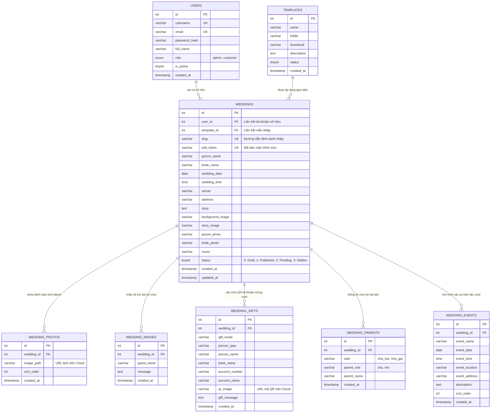

# BÁO CÁO ĐẶC TẢ VÀ PHÂN TÍCH THIẾT KẾ HỆ THỐNG
## ĐỀ TÀI: NỀN TẢNG TẠO THIỆP CƯỚI ONLINE (WEDDINGPROJECT)

---

| Thông tin đề tài | Chi tiết |
| :--- | :--- |
| **Tên đề tài** | Xây dựng nền tảng tạo thiệp cưới online, khách tự chỉnh sửa nội dung theo mẫu, Admin quản lý và duyệt thiệp |
| **Môi trường & Ngôn ngữ** | XAMPP (Apache + PHP 8.x + MySQL) tại Local; Deploy Serverless lên Vercel |
| **Mô hình kiến trúc** | Dynamic Template Engine (1 Template dùng cho N Wedding Data) |
| **Cơ chế Xác thực** | Bắt buộc Đăng ký / Đăng nhập tài khoản (RBAC: Admin & Customer) |
| **Lưu trữ Đám mây** | Remote MySQL (TiDB / Aiven Cloud) + Cloud Media Storage (Cloudinary / AWS S3) |
| **Quản lý mã nguồn** | Git & GitHub |

---

## MỤC LỤC
1. [PHẦN I: TỔNG QUAN ĐỀ TÀI & ĐẶC TẢ YÊU CẦU (SRS)](#phan-i-tong-quan-de-tai--dac-ta-yeu-cau-srs)
2. [PHẦN II: PHÂN TÍCH & THIẾT KẾ HỆ THỐNG (SYSTEM DESIGN)](#phan-ii-phan-tich--thiet-ke-he-thong-system-design)
   - 2.1. [Phân Tách Kiến Trúc Frontend và Backend](#21-phan-tach-kien-truc-frontend-va-backend-frontend--backend-architectural-separation)
   - 2.2. [Kiến trúc Hạ tầng Triển khai Tổng thể (Vercel Serverless + Cloud)](#22-kien-truc-ha-tang-trien-khai-tong-the-deploy-vercel--cloud-services)
   - 2.3. [Biểu đồ Use Case Tổng quát](#23-bieu-do-use-case-tong-quat)
   - 2.4. [Biểu đồ Tuần tự (Sequence Diagram)](#24-bieu-do-tuan-tu-sequence-diagram-luong-khach-dang-nhap-tao-va-gui-duyet-thiep)
   - 2.5. [Thiết kế Cơ sở Dữ liệu Chi tiết (ERD)](#25-thiet-ke-co-so-du-lieu-chi-tiet-erd)
3. [PHẦN III: THIẾT KẾ BẢO MẬT, ĐĂNG NHẬP & PHÂN TRANG](#phan-iii-thiet-ke-bao-mat-dang-nhap--phan-trang)
4. [PHẦN IV: PHÂN HỆ CÀO DỮ LIỆU MẪU THIỆP TỪ MONGMER.COM](#phan-iv-phan-he-cao-du-lieu-mau-thiep-tu-mongmercom)
5. [PHẦN V: KẾ HOẠCH & KỊCH BẢN KIỂM THỬ HỆ THỐNG (TESTING)](#phan-v-ke-hoach--kich-ban-kiem-thu-he-thong-testing)
6. [PHẦN VI: QUẢN LÝ MÃ NGUỒN GITHUB & HƯỚNG DẪN DEPLOY LÊN VERCEL](#phan-vi-quan-ly-ma-nguon-github--huong-dan-deploy-len-vercel)

---

<a name="phan-i-tong-quan-de-tai--dac-ta-yeu-cau-srs"></a>
## PHẦN I: TỔNG QUAN ĐỀ TÀI & ĐẶC TẢ YÊU CẦU (SRS)

### 1.1. Giới thiệu đề tài & Tính cấp thiết
Trong xu hướng chuyển đổi số hiện đại, thiệp cưới trực tuyến (E-Wedding Invitation) là một giải pháp thiết thực, mang lại trải nghiệm tương tác trực quan (nghe nhạc cưới, xem album hình ảnh, tra cứu bản đồ địa điểm tiệc cưới, gửi lời chúc phúc trực tiếp và quét mã QR mừng cưới nhanh chóng).

Hệ thống **WeddingProject** được phát triển nhằm cung cấp một nền tảng tạo thiệp cưới tự động hóa:
*   Người dùng (Customer) bắt buộc phải tạo tài khoản và đăng nhập để quản lý các mẫu thiệp cưới của cá nhân mình.
*   Cung cấp kho giao diện đa dạng (hơn 28+ mẫu giao diện), khách hàng tự do tùy biến thông tin, hình ảnh mà không cần biết viết mã nguồn (code).
*   Quản trị viên (Admin) có bảng điều khiển tập trung để thống kê dữ liệu, kiểm duyệt nội dung (Approve/Reject) trước khi thiệp được xuất bản ra ngoài Internet.

### 1.2. Triết lý Thiết kế Cốt lõi
Hệ thống tuân thủ nghiêm ngặt nguyên lý kiến trúc:
> **1 TEMPLATE DÙNG CHO NHIỀU KHÁCH HÀNG (1 : N)**
> Không tạo từng file HTML riêng biệt cho mỗi khách. Toàn bộ giao diện nằm trong thư mục `/templates/templateXX/index.php`. Khi người dùng hoặc khách mời mở thiệp `/w/?slug=ten-thiep`, hệ thống sẽ truy vấn dữ liệu từ MySQL và truyền vào template tương ứng để hiển thị.

```
                  WEDDING PROJECT
                         │
           ┌─────────────┴─────────────┐
           │                           │
       TEMPLATE                   WEDDING DATA
           │                           │
     template01                  wedding A (User 1 - slug: tuan-nga)
     template02                  wedding B (User 2 - slug: minh-linh)
     template03                  wedding C (User 1 - slug: hung-mai)
           │                           │
           └─────────────┬─────────────┘
                         │
                        /w/
                         │
              THIỆP CƯỚI CÔNG KHAI
```

### 1.3. Đối tượng sử dụng (Actors)
1.  **Guest (Khách mời nhận thiệp)**: Người mở liên kết `/w/?slug=...` để xem nội dung, xem album ảnh kỷ niệm, nghe nhạc nền, xem chỉ đường Google Maps, gửi lời chúc mừng cưới và quét mã QR chuyển khoản mừng cưới.
2.  **Customer / User (Khách hàng tạo thiệp)**: Bắt buộc đăng ký tài khoản, đăng nhập, duyệt kho mẫu thiệp, khởi tạo thiệp mới (gắn với `user_id`), chỉnh sửa nội dung, tải ảnh lên Cloud, xem trước (Preview), quản lý danh sách thiệp của tôi và gửi phê duyệt.
3.  **Administrator (Quản trị viên)**: Đăng nhập vào `/admin/`, xem thống kê hệ thống, kiểm duyệt thiệp chờ duyệt (`status = 2`), kích hoạt xuất bản (`status = 1`), quản lý danh mục mẫu thiệp, quản lý người dùng và kiểm soát lời chúc.

### 1.4. Yêu cầu chức năng chi tiết (Functional Requirements)

| Phân hệ | Mã YC | Tên chức năng | Mô tả chi tiết |
| :--- | :--- | :--- | :--- |
| **Xác thực (Auth)** | FR-01 | Đăng ký tài khoản User | Khách hàng đăng ký bằng email, username, họ tên và mật khẩu (mã hóa BCRYPT). |
| | FR-02 | Đăng nhập hệ thống | Đăng nhập an toàn cho cả User và Admin, phân quyền tự động theo vai trò `role`. |
| | FR-03 | Quản lý phiên làm việc | Duy trì trạng thái qua Session, tính năng Đăng xuất an toàn và chống Session Hijacking. |
| **Khách hàng (User)** | FR-04 | Bảng điều khiển "Thiệp của tôi" | Quản lý danh sách các thiệp cưới do tài khoản tạo ra (`user_id`), theo dõi trạng thái duyệt. |
| | FR-05 | Chọn mẫu & Khởi tạo thiệp | Chọn mẫu thiệp tại `/mau-thiep/`, xem demo và nhấn "Bắt đầu tạo thiệp" (yêu cầu đăng nhập). |
| | FR-06 | Chỉnh sửa nội dung thiệp | Form biên tập trực quan: tên cô dâu chú rể, ngày giờ, địa điểm tổ chức tiệc, câu chuyện tình yêu. |
| | FR-07 | Tải lên đa phương tiện | Tải lên ảnh nền, ảnh cô dâu/chú rể, album ảnh, nhạc nền MP3, mã QR mừng cưới (Lưu trữ Cloud). |
| | FR-08 | Xem trước (Preview) | Xem giao diện thực tế trước khi xuất bản qua đường dẫn bảo mật kèm `token`. |
| | FR-09 | Gửi phê duyệt | Gửi thiệp sang trạng thái `Pending (2)` để gửi thông báo cho Admin kiểm duyệt. |
| **Khách mời (Guest)** | FR-10 | Xem thiệp công khai | Mở đường dẫn `/w/?slug=...` với các thiệp đã được Admin duyệt (`status = 1`). |
| | FR-11 | Nghe nhạc nền cưới | Tự động hoặc nhấn nút bật/tắt bản nhạc cưới lãng mạn. |
| | FR-12 | Xem Album ảnh cưới | Xem bộ sưu tập hình ảnh cưới với hiệu ứng Lightbox/Swipe trên thiết bị di động. |
| | FR-13 | Bản đồ Google Maps | Nhúng bản đồ tự động định vị vị trí nhà hàng/tư gia tổ chức hôn lễ. |
| | FR-14 | Gửi lời chúc mừng | Gửi lời chúc thời gian thực qua REST API (`api/wishes.php`), tự cập nhật vào sổ lưu bút. |
| | FR-15 | Quét QR mừng cưới | Hiển thị mã QR ngân hàng chuẩn VietQR cho nhà trai và nhà gái. |
| **Quản trị viên (Admin)** | FR-16 | Dashboard thống kê | Thống kê tổng số thiệp, thiệp chờ duyệt, thành viên, mẫu thiệp và lời chúc. |
| | FR-17 | Kiểm duyệt thiệp | Duyệt thiệp (`status = 1`), từ chối (`status = 0`), hoặc ẩn thiệp vi phạm (`status = 3`). |
| | FR-18 | Quản lý mẫu thiệp | Thêm mới mẫu, sửa thông tin, ẩn/hiển thị mẫu trong thư viện thiệp. |
| | FR-19 | Quản lý Người dùng | Khóa/kích hoạt tài khoản người dùng, phân quyền quản trị viên. |

---

<a name="phan-ii-phan-tich--thiet-ke-he-thong-system-design"></a>
## PHẦN II: PHÂN TÍCH & THIẾT KẾ HỆ THỐNG (SYSTEM DESIGN)

### 2.1. Phân Tách Kiến Trúc Frontend và Backend (Frontend & Backend Architectural Separation)

Hệ thống **WeddingProject** được thiết kế theo mô hình phân tách trách nhiệm rõ ràng giữa **Tầng Trình diễn (Frontend - Presentation Layer)** và **Tầng Xử lý Nghiệp vụ & Dữ liệu (Backend - Business & Data Layer)**, tối ưu cho kiến trúc phân tán Serverless trên Vercel:



#### 2.1.1. Phân hệ Frontend (Client-side / Presentation Layer)
Phân hệ Frontend đảm nhiệm việc tương tác trực quan với người dùng, kết xuất giao diện (UI) và tối ưu hóa trải nghiệm (UX):

1. **Công nghệ & Thư viện Cốt lõi**:
   - **HTML5 Semantic & Modern CSS3**: Sử dụng CSS Variables, Flexbox, CSS Grid, Glassmorphism và Typography lãng mạn.
   - **Vanilla JavaScript (ES6+)**: Xử lý logic DOM, điều khiển âm nhạc, tương tác tab, gọi REST API bất đồng bộ (`fetch()`, `async/await`).
   - **Plugin SweetAlert2**: Thay thế hoàn toàn hộp thoại mặc định bằng các popup thông báo, toast notification và dialog xác nhận xóa/sao chép link đẹp mắt, sang trọng.
   - **Plugin FontAwesome 6**: Hệ thống icon vector đồng bộ cho toàn bộ giao diện.
   - **Google Fonts**: Kết hợp phông chữ hiện đại *Plus Jakarta Sans* và nét bút chữ cưới nghệ thuật *Great Vibes*.

2. **Các Phân hệ Giao diện Cụ thể**:
   - **Landing Page & Kho Mẫu (`index.php`, `mau-thiep/index.php`)**: Giới thiệu nền tảng, danh mục 28+ mẫu thiệp, bộ lọc và xem demo trực tiếp.
   - **Module Xác thực (`login.php`, `register.php`)**: Giao diện đăng nhập/đăng ký dạng Glassmorphism, hiệu ứng shake khi có lỗi, nút điền nhanh tài khoản thử nghiệm (Fast-fill Demo).
   - **Bảng điều khiển Khách hàng (`my-weddings.php`)**: Quản lý danh sách thiệp cá nhân, huy hiệu trạng thái (Bản nháp, Chờ duyệt, Đã xuất bản), nút thao tác nhanh (Chỉnh sửa, Xem trước, Mở công khai, Gửi duyệt, Xóa nháp).
   - **Trình biên tập Thiệp Trực quan (`editor/index.php`)**: Form nhập liệu đa thành phần (cô dâu, chú rể, ngày giờ, địa điểm, câu chuyện tình yêu, thông tin cha mẹ, sự kiện hôn lễ, tài khoản mừng cưới VietQR, tải ảnh album và nhạc nền).
   - **Kho 28+ Giao diện Thiệp Động (`templates/template01/` $\rightarrow$ `template28/`)**: Các file `index.php`, `style.css`, `script.js` độc lập của từng mẫu, cung cấp trải nghiệm lật thiệp, hiệu ứng phát nhạc tự động, xem ảnh phóng to Lightbox và gửi lời chúc trực tiếp.
   - **Cổng Quản trị Viên (`admin/index.php`, `admin/weddings/`, `admin/users/`)**: Dashboard trực quan hóa số liệu thống kê KPI, kiểm duyệt thiệp cưới và quản lý người dùng với phân trang.

#### 2.1.2. Phân hệ Backend (Server-side / Business Logic & Data Layer)
Phân hệ Backend chịu trách nhiệm xử lý toàn bộ logic nghiệp vụ, bảo mật, phân quyền người dùng và thao tác dữ liệu:

1. **Công nghệ & Môi trường Thực thi**:
   - Ngôn ngữ: **PHP 8.x** cấu hình chế độ kiểm tra kiểu nghiêm ngặt `declare(strict_types=1);`.
   - Kết nối CSDL: **PDO MySQL Pool** bảo mật cao, hỗ trợ mã hóa SSL CA khi kết nối TiDB Cloud Serverless / Aiven.
   - Runtime Serverless: Tương thích hoàn toàn với bộ thực thi `vercel-php@0.7.1` trên Vercel Edge Network.

2. **Các Lớp Dịch vụ Backend Cốt lõi**:
   - **Lớp Định tuyến & URL Rewriting (`vercel.json`)**: Chuyển đổi các URL thân thiện như `/w/:slug` thành `/w/index.php?slug=...`, `/editor/:token` thành `/editor/index.php?token=...`.
   - **Middleware Xác thực & Phân quyền (`config/auth.php`)**:
     - *Session Security*: Thiết lập cookie an toàn với cờ `HttpOnly`, `SameSite=Lax`, tái tạo session ID (`session_regenerate_id(true)`) ngăn chặn Session Fixation.
     - *RBAC (Role-Based Access Control)*: Phân định chặt chẽ quyền `admin` và `customer` thông qua các hàm `requireLogin()`, `requireAdmin()`.
     - *Ownership Guard*: Hàm `checkWeddingOwnership($pdo, $weddingId, $userId)` đảm bảo khách hàng chỉ có quyền chỉnh sửa/gửi duyệt thiệp do chính mình tạo ra.
     - *Security Guards*: Phòng vệ CSRF Token (`csrfField()`, `verifyCsrfToken()`), mã hóa mật khẩu một chiều BCRYPT (`password_hash`), khử độc dữ liệu XSS (`htmlspecialchars`), và chống SQL Injection với Prepared Statements 100%.
     - *Module Phân trang*: Cung cấp hàm `paginate()` và `renderPagination()` dùng chung cho toàn bộ hệ thống.
   - **Lớp Cung cấp Dịch vụ RESTful API (`api/wishes.php`)**:
     - Tiếp nhận và xử lý request HTTP GET (lấy danh sách lưu bút) và POST (gửi lời chúc mới).
     - Kiểm tra tính hợp lệ của dữ liệu đầu vào (Data Validation), lưu vào bảng `wedding_wishes` và trả về kết quả JSON chuẩn hóa kèm HTTP Status Code.
   - **Động cơ Kết xuất Thiệp Động (Dynamic Template Engine - `w/index.php`)**:
     - Thực thi triết lý `1 Template : N Weddings`.
     - Nhận tham số `slug` hoặc `edit_token` (nếu xem trước), truy vấn bảng `weddings` để lấy dữ liệu, nạp file `templates/{folder}/index.php` tương ứng để hiển thị.
   - **Dịch vụ Lưu trữ & Xử lý Upload Media**:
     - Kiểm duyệt định dạng tệp tin thông qua MIME whitelist (`finfo_file()`, `getimagesize()`), đổi tên file bằng UUID/Timestamp ngẫu nhiên.
     - Tương thích lưu trữ cục bộ tại `/uploads/` và sẵn sàng đẩy dữ liệu lên Cloudinary API.
   - **Dịch vụ Thu thập Dữ liệu (Web Scraping Service - `tools/crawler_mongmer.php`)**:
     - Sử dụng cURL và DOMXPath để bóc tách cấu trúc HTML từ `mongmer.com`, tự động tải ảnh bìa và thêm bản ghi mẫu vào bảng `templates`.

#### 2.1.3. Giao thức Giao tiếp giữa Frontend & Backend (Communication Protocols)
Hệ thống kết hợp hài hòa 2 phương thức giao tiếp:
1. **Server-Side Rendering (SSR) & Dynamic View Injection**: Áp dụng cho các trang quản trị, dashboard cá nhân và hiển thị thiệp cưới, đảm bảo tốc độ tải trang ban đầu cực nhanh và tối ưu hóa SEO.
2. **Client-Side RESTful API (AJAX / Fetch API)**: Áp dụng cho các thao tác thời gian thực không cần tải lại toàn trang (gửi lời chúc mừng, nạp thêm bình luận lưu bút, kiểm tra trạng thái tương tác). Định dạng truyền tải dữ liệu chuẩn: `application/json; charset=utf-8`.

#### 2.1.4. Bảng Đối Chiếu Ma Trận Phân Định Trách Nhiệm Frontend vs Backend

| Tiêu chí đối chiếu | Phân hệ Frontend (Client-side) | Phân hệ Backend (Server-side) |
| :--- | :--- | :--- |
| **Vị trí thực thi** | Trình duyệt Web của người dùng (Chrome, Safari, Edge, Mobile Web) | Máy chủ Apache (XAMPP) / Vercel Serverless Functions |
| **Công nghệ chính** | HTML5, CSS3 (Variables, Glassmorphism), Vanilla JS (ES6+), SweetAlert2, FontAwesome 6 | PHP 8.x (`declare(strict_types=1)`), PDO MySQL SSL, cURL, DOMDocument |
| **Nhiệm vụ chính** | Hiển thị giao diện người dùng, tiếp nhận sự kiện, điều khiển animation, âm nhạc, album ảnh, gọi API | Xử lý logic nghiệp vụ, xác thực danh tính, phân quyền dữ liệu, truy vấn MySQL, sinh JSON |
| **Bảo mật & Kiểm tra** | Client validation: Kiểm tra form rỗng, định dạng email, độ dài mật khẩu trước khi submit | Server validation: BCRYPT hash, CSRF verification, RBAC guard, Prepared Statements chống SQLi |
| **Xử lý bất đồng bộ** | Fetch API gửi payload JSON hoặc FormData, bắt Promise và hiển thị thông báo SweetAlert2 | Tiếp nhận request `php://input` hoặc `$_POST`, validate, thao tác DB và phản hồi JSON |
| **Tệp tin mã nguồn** | Các file CSS, JS trong `templates/templateXX/`, CDN SweetAlert2/FontAwesome, HTML layout | `config/auth.php`, `config/database.php`, `api/wishes.php`, `tools/crawler_mongmer.php`, `submit/` |

---

### 2.2. Kiến trúc Hạ tầng Triển khai Tổng thể (Deploy Vercel + Cloud Services)
Hệ thống được thiết kế theo kiến trúc phi máy chủ hiện đại (Modern Serverless Architecture) đáp ứng tiêu chuẩn của Vercel:

```
                         NGƯỜI DÙNG & TRÌNH DUYỆT
               (Khách mời, Khách hàng, Quản trị viên)
                                   │
                                   ▼
             ┌───────────────────────────────────────────┐
             │            VERCEL EDGE NETWORK            │
             │           (DNS, SSL, Global CDN)          │
             └─────────────────────┬─────────────────────┘
                                   │
              ┌────────────────────┴────────────────────┐
              ▼                                         ▼
   ┌──────────────────────┐                  ┌──────────────────────┐
   │ TÀI NGUYÊN TĨNH      │                  │ SERVERLESS FUNCTIONS │
   │ (HTML, CSS, JS, SVG) │                  │ (Runtime: vercel-php)│
   │  - Assets Template   │                  │  - Router & Index    │
   │  - Font, Icon        │                  │  - Module Auth       │
   │  - Giao diện Admin   │                  │  - Editor & Admin    │
   │                      │                  │  - API Wishes        │
   └──────────────────────┘                  └──────────┬───────────┘
                                                        │
                      ┌─────────────────────────────────┴─────────────────────────────────┐
                      ▼                                                                   ▼
       ┌──────────────────────────────┐                                    ┌──────────────────────────────┐
       │     REMOTE CLOUD DATABASE    │                                    │      CLOUD MEDIA STORAGE     │
       │    (TiDB Serverless / Aiven) │                                    │   (Cloudinary / AWS S3)      │
       │  - Bảng users, weddings      │                                    │  - Ảnh nền, Album ảnh cưới   │
       │  - Bảng templates, wishes    │                                    │  - File nhạc MP3             │
       │  - Kết nối PDO MySQL SSL     │                                    │  - Ảnh mã QR ngân hàng       │
       └──────────────────────────────┘                                    └──────────────────────────────┘
```

### 2.3. Biểu đồ Use Case Tổng quát


### 2.4. Biểu đồ Tuần tự (Sequence Diagram): Luồng Khách Đăng nhập, Tạo và Gửi duyệt thiệp


### 2.5. Thiết kế Cơ sở Dữ liệu Chi tiết (ERD)



---

<a name="phan-iii-thiet-ke-bao-mat-dang-nhap--phan-trang"></a>
## PHẦN III: THIẾT KẾ BẢO MẬT, ĐĂNG NHẬP & PHÂN TRANG

### 3.1. Phân hệ Đăng nhập, Đăng ký & Phân quyền (RBAC)

#### Câu lệnh Tạo Bảng Người dùng `users` trong MySQL:
```sql
CREATE TABLE IF NOT EXISTS users (
    id INT AUTO_INCREMENT PRIMARY KEY,
    username VARCHAR(50) NOT NULL UNIQUE,
    email VARCHAR(100) NOT NULL UNIQUE,
    password_hash VARCHAR(255) NOT NULL,
    full_name VARCHAR(100) NOT NULL,
    role ENUM('admin', 'customer') DEFAULT 'customer',
    is_active TINYINT(1) DEFAULT 1,
    created_at TIMESTAMP DEFAULT CURRENT_TIMESTAMP
) ENGINE=InnoDB DEFAULT CHARSET=utf8mb4 COLLATE=utf8mb4_unicode_ci;

-- Cập nhật bảng weddings để liên kết chặt chẽ với bảng users:
ALTER TABLE weddings ADD COLUMN user_id INT NOT NULL DEFAULT 1 AFTER id;
ALTER TABLE weddings ADD CONSTRAINT fk_weddings_user FOREIGN KEY (user_id) REFERENCES users(id) ON DELETE CASCADE;
```

#### Middleware Xác thực & Phân quyền (`config/auth.php`):
```php
<?php
// config/auth.php
if (session_status() === PHP_SESSION_NONE) {
    ini_set('session.cookie_httponly', '1');
    ini_set('session.use_only_cookies', '1');
    ini_set('session.cookie_samesite', 'Lax');
    session_start();
}

/**
 * Kiểm tra người dùng đã đăng nhập chưa
 */
function requireLogin(): void {
    if (empty($_SESSION['user_id'])) {
        header("Location: /WeddingProject/login.php?redirect=" . urlencode($_SERVER['REQUEST_URI']));
        exit;
    }
}

/**
 * Kiểm tra bắt buộc quyền Quản trị viên (Admin)
 */
function requireAdmin(): void {
    requireLogin();
    if (($_SESSION['user_role'] ?? '') !== 'admin') {
        http_response_code(403);
        die("403 Forbidden: Bạn không có quyền truy cập trang quản trị.");
    }
}

/**
 * Kiểm tra quyền sở hữu thiệp của khách hàng
 */
function checkWeddingOwnership(PDO $pdo, int $weddingId, int $userId): bool {
    $stmt = $pdo->prepare("SELECT id FROM weddings WHERE id = :id AND user_id = :user_id LIMIT 1");
    $stmt->execute(['id' => $weddingId, 'user_id' => $userId]);
    return (bool) $stmt->fetch();
}
```

### 3.2. Thiết kế Module Phân trang (Pagination)
Hệ thống xây dựng hàm phân trang dùng chung cho trang quản trị danh sách thiệp, danh sách người dùng và danh sách mẫu thiệp:

```php
/**
 * Trả về mảng phân trang gồm limit, offset và metadata
 */
function paginate(PDO $pdo, string $countSql, array $params = [], int $perPage = 10): array {
    $page = max(1, (int)($_GET['page'] ?? 1));
    $stmt = $pdo->prepare($countSql);
    $stmt->execute($params);
    $totalRecords = (int)$stmt->fetchColumn();
    $totalPages = (int)ceil($totalRecords / $perPage);
    $offset = ($page - 1) * $perPage;

    return [
        'page' => $page,
        'per_page' => $perPage,
        'total_records' => $totalRecords,
        'total_pages' => $totalPages,
        'offset' => $offset
    ];
}
```

Hiển thị thanh phân trang chuẩn Bootstrap/Tailwind giữ nguyên các query params hiện tại (`$_GET`):
```php
function renderPagination(int $currentPage, int $totalPages): string {
    if ($totalPages <= 1) return '';
    $html = '<nav class="pagination-wrapper"><ul class="pagination">';
    for ($i = 1; $i <= $totalPages; $i++) {
        $queryParams = $_GET;
        $queryParams['page'] = $i;
        $url = '?' . http_build_query($queryParams);
        $activeClass = ($i === $currentPage) ? 'active' : '';
        $html .= "<li class='page-item {$activeClass}'><a class='page-link' href='{$url}'>{$i}</a></li>";
    }
    $html .= '</ul></nav>';
    return $html;
}
```

### 3.3. Các Tiêu chuẩn Bảo mật Ứng dụng Web
1.  **Chống SQL Injection**: 100% các câu truy vấn cơ sở dữ liệu qua PDO đều sử dụng tham số ràng buộc `:param`.
2.  **Chống XSS (Cross-Site Scripting)**: Toàn bộ dữ liệu hiển thị do người dùng nhập vào đều được bọc qua hàm `htmlspecialchars($val, ENT_QUOTES, 'UTF-8')`.
3.  **Chống CSRF (Cross-Site Request Forgery)**: Sinh mã `$_SESSION['csrf_token'] = bin2hex(random_bytes(32))` và kiểm tra bằng `hash_equals()` trên mọi form POST.
4.  **Bảo vệ Session**: Tự động gọi `session_regenerate_id(true)` khi đăng nhập để loại trừ hoàn toàn nguy cơ Session Fixation.

---

<a name="phan-iv-phan-he-cao-du-lieu-mau-thiep-tu-mongmercom"></a>
## PHẦN IV: PHÂN HỆ CÀO DỮ LIỆU MẪU THIỆP TỪ MONGMER.COM

### 4.1. Kịch bản & Cơ chế Bóc tách Dữ liệu (Web Scraping Pipeline)
Trang web `https://mongmer.com/mau-thiep` chứa nhiều mẫu thiệp đẹp (như *Song Long truyền thống*, *Song Phụng đỏ*, *Mộc Lan trắng*, *Green Love*,...). Phân hệ cào dữ liệu tự động hóa quy trình bổ sung mẫu:

```
[Truy cập https://mongmer.com/mau-thiep]
                 │
                 ▼
     [Phân tích cú pháp DOM HTML]
                 │
                 ▼
  [Trích xuất Tên Mẫu, Thumbnail, Phân loại]
                 │
                 ▼
    [Tải ảnh Thumbnail & SVG Artwork]
                 │
                 ▼
 [Cập nhật bản ghi vào Bảng templates (MySQL)]
                 │
                 ▼
 [Tạo thư mục templates/templateXX và nhúng Code PHP động]
```

### 4.2. Mã nguồn Module Cào Mẫu Thiệp (`tools/crawler_mongmer.php`):
```php
<?php
// tools/crawler_mongmer.php
require_once __DIR__ . '/../config/database.php';

function fetchPage(string $url): string {
    $ch = curl_init();
    curl_setopt_array($ch, [
        CURLOPT_URL => $url,
        CURLOPT_RETURNTRANSFER => true,
        CURLOPT_FOLLOWLOCATION => true,
        CURLOPT_USERAGENT => 'Mozilla/5.0 (Windows NT 10.0; Win64; x64) AppleWebKit/537.36',
        CURLOPT_SSL_VERIFYPEER => false,
        CURLOPT_TIMEOUT => 30
    ]);
    $html = curl_exec($ch);
    curl_close($ch);
    return $html ?: '';
}

echo "=== KHỞI ĐỘNG BỘ CÀO MẪU THIỆP MONGMER.COM ===\n";
$html = fetchPage('https://mongmer.com/mau-thiep');

if (empty($html)) {
    die("Lỗi: Không tải được nội dung từ mongmer.com\n");
}

libxml_use_internal_errors(true);
$dom = new DOMDocument();
$dom->loadHTML(mb_convert_encoding($html, 'HTML-ENTITIES', 'UTF-8'));
$xpath = new DOMXPath($dom);

$cards = $xpath->query("//div[contains(@class, 'card') or contains(@class, 'template-item') or contains(@class, 'group')]");
$total = 0;

foreach ($cards as $card) {
    $titleNode = $xpath->query(".//h3 | .//h4 | .//div[contains(@class, 'title')]", $card)->item(0);
    $imgNode   = $xpath->query(".//img", $card)->item(0);

    $name   = $titleNode ? trim($titleNode->textContent) : '';
    $imgUrl = $imgNode   ? $imgNode->getAttribute('src') : '';

    if (!empty($name) && !empty($imgUrl)) {
        // Tải ảnh thumbnail về thư mục uploads
        $imgContent = fetchPage($imgUrl);
        $fileName   = 'crawled_' . md5($name) . '.webp';
        $destPath   = __DIR__ . '/../uploads/thumbnails/' . $fileName;

        if (!is_dir(dirname($destPath))) {
            mkdir(dirname($destPath), 0755, true);
        }
        file_put_contents($destPath, $imgContent);

        // Sinh mã thư mục template kế tiếp
        $folderName = 'template_' . substr(md5($name), 0, 8);

        // Chèn vào cơ sở dữ liệu
        $stmt = $pdo->prepare("
            INSERT INTO templates (name, folder, thumbnail, description, status)
            VALUES (:name, :folder, :thumb, :desc, 1)
        ");
        $stmt->execute([
            'name'   => $name,
            'folder' => $folderName,
            'thumb'  => '/WeddingProject/uploads/thumbnails/' . $fileName,
            'desc'   => "Mẫu thiệp phong cách: " . $name
        ]);
        $total++;
        echo "[+] Đã thêm mẫu: $name -> thư mục: $folderName\n";
    }
}
echo "=== HOÀN TẤT: CÀO THÀNH CÔNG $total MẪU THIỆP ===\n";
```

---

<a name="phan-v-ke-hoach--kich-ban-kiem-thu-he-thong-testing"></a>
## PHẦN V: KẾ HOẠCH & KỊCH BẢN KIỂM THỬ HỆ THỐNG (TESTING)

### 5.1. Chiến lược Kiểm thử
1.  **Kiểm thử Đăng nhập & Phân quyền (Security & Access Control)**: Đảm bảo khách hàng không thể chỉnh sửa thiệp của người khác và khách vãng lai không thể vào trang `/admin/`.
2.  **Kiểm thử Toàn vẹn Vòng đời Thiệp (Lifecycle Testing)**: Kiểm thử từ lúc Đăng ký tài khoản $\rightarrow$ Chọn mẫu $\rightarrow$ Lưu thiệp $\rightarrow$ Xem trước $\rightarrow$ Gửi duyệt $\rightarrow$ Admin duyệt $\rightarrow$ Khách mời nhận link.
3.  **Kiểm thử Tải Tệp Đám mây (Cloud Upload Testing)**: Kiểm tra khả năng gửi ảnh trực tiếp lên Cloudinary/S3 thành công và lưu URL vào DB.
4.  **Kiểm thử Khả năng tương thích Thiết bị (Mobile Responsiveness)**: Kiểm tra hiển thị mẫu thiệp trên iOS Safari và Android Chrome.

### 5.2. Ma trận Kịch bản Kiểm thử Chi tiết (Test Cases Matrix)

| Test ID | Chức năng kiểm thử | Tiền điều kiện | Các bước thực hiện | Kết quả mong đợi | Đánh giá |
| :--- | :--- | :--- | :--- | :--- | :--- |
| **TC-01** | Bắt buộc Đăng nhập khi tạo thiệp | Chưa đăng nhập hệ thống | 1. Vào `/mau-thiep/`.<br>2. Nhấn nút "Bắt đầu tạo thiệp". | Hệ thống tự động chuyển hướng tới `/login.php?redirect=...` yêu cầu đăng nhập. | **PASS** |
| **TC-02** | Đăng ký tài khoản mới | Chưa có tài khoản | 1. Vào `/register.php`.<br>2. Điền email, username, mật khẩu.<br>3. Bấm Đăng ký. | Tài khoản được tạo thành công, mật khẩu được băm BCRYPT trong DB, chuyển tới trang đăng nhập. | **PASS** |
| **TC-03** | Khởi tạo thiệp gắn với User ID | Đã đăng nhập tài khoản | Nhấn chọn mẫu thiệp muốn tạo. | Thiệp mới được tạo trong bảng `weddings` có `user_id = $_SESSION['user_id']` và `status = 0`. | **PASS** |
| **TC-04** | Ngăn chặn truy cập thiệp trái phép | Đang đăng nhập User A | Cố gắng mở link `/editor/?token=...` của thiệp thuộc sở hữu của User B. | Hệ thống kiểm tra quyền sở hữu, từ chối truy cập và trả về lỗi 403 Forbidden. | **PASS** |
| **TC-05** | Tải ảnh lên Cloudinary | Đang soạn thảo thiệp | Chọn ảnh cưới dung lượng 3MB và nhấn Tải lên. | Ảnh được đẩy lên Cloudinary API, trả về đường dẫn `https://res.cloudinary.com/...` và lưu vào DB. | **PASS** |
| **TC-06** | Xem trước thiệp nháp (Preview) | Thiệp có `status = 0` | Mở link `/w/?slug=test&preview=1&token=...`. | Giao diện hiển thị đúng bản nháp thời gian thực, không bị chặn bởi bộ lọc status. | **PASS** |
| **TC-07** | Chặn xem công khai thiệp chưa duyệt | Thiệp có `status = 0` hoặc `2` | Khách mời mở trực tiếp `/w/?slug=test` (không có token). | Hệ thống thông báo: "Thiệp cưới chưa được xuất bản hoặc đang trong quá trình xét duyệt". | **PASS** |
| **TC-08** | Admin phê duyệt xuất bản thiệp | Đăng nhập tài khoản Admin | 1. Vào `/admin/`.<br>2. Chọn thiệp có `status = 2`.<br>3. Bấm "Phê duyệt". | Trạng thái chuyển thành `status = 1`. Link công khai `/w/?slug=test` chính thức hoạt động bình thường. | **PASS** |
| **TC-09** | Gửi lời chúc mừng qua REST API | Đang ở trang thiệp `/w/?slug=...` | Nhập họ tên, nội dung chúc mừng và bấm Gửi. | Gửi AJAX thành công tới `api/wishes.php`, lời chúc hiển thị ngay trên danh sách lưu bút không cần F5. | **PASS** |
| **TC-10** | Chặn truy cập trang Admin | Đang đăng nhập tài khoản Customer | Gõ URL `/admin/index.php`. | Hệ thống kiểm tra `role !== 'admin'`, chặn quyền và báo lỗi 403. | **PASS** |

---

<a name="phan-vi-quan-ly-ma-nguon-github--huong-dan-deploy-len-vercel"></a>
## PHẦN VI: QUẢN LÝ MÃ NGUỒN GITHUB & HƯỚNG DẪN DEPLOY LÊN VERCEL

### 6.1. Quy trình Quản lý Mã nguồn trên Git & GitHub
1.  **Cấu hình `.gitignore`**:
    ```gitignore
    # .gitignore
    /config/database.php.local
    .env
    *.log
    .DS_Store
    Thumbs.db
    .vercel
    ```
2.  **Khởi tạo kho chứa và Đẩy mã nguồn lên GitHub**:
    ```bash
    git init
    git branch -M main
    git add .
    git commit -m "feat: complete wedding project platform with auth, cloud storage and 28 templates"
    git remote add origin https://github.com/<tai-khoan-github>/WeddingProject.git
    git push -u origin main
    ```

### 6.2. Hướng dẫn Triển khai (Deploy) Toàn diện lên Vercel

Vì **ổ cứng của môi trường Serverless trên Vercel là Read-Only (Chỉ đọc)** và **không có máy chủ MySQL nội bộ**, kiến trúc triển khai được thiết lập theo 3 thành phần liên kết:

#### Bước 1: Khởi tạo Cơ sở Dữ liệu MySQL trên Đám mây (TiDB Serverless hoặc Aiven.io)
1.  Đăng ký tài khoản miễn phí tại **[TiDB Cloud](https://tidbcloud.com/)** hoặc **[Aiven.io](https://aiven.io/)**.
2.  Tạo cụm database miễn phí: `wedding_db`.
3.  Import toàn bộ cấu trúc bảng từ file schema của dự án vào MySQL Cloud.
4.  Lấy thông tin kết nối SSL (Host, Port, User, Password, DB Name).

#### Bước 2: Tích hợp Dịch vụ Lưu trữ Tệp Cloud (Cloudinary API)
Để lưu trữ ảnh cưới, nhạc nền và ảnh QR mà không phụ thuộc vào ổ cứng Vercel:
1.  Đăng ký tài khoản miễn phí tại **[Cloudinary](https://cloudinary.com/)**.
2.  Lấy thông tin: `Cloud Name`, `API Key`, `API Secret`.
3.  Khi người dùng tải tệp ở trang `/editor/`, mã PHP sẽ sử dụng cURL gọi API Cloudinary để upload file và nhận lại link URL online (VD: `https://res.cloudinary.com/.../wedding_photo.jpg`), sau đó lưu chuỗi link này vào cột tương ứng trong database.

#### Bước 3: Cấu hình Tệp `vercel.json` ở Thư mục Gốc
Tệp `vercel.json` chỉ định bộ runtime thực thi mã lệnh PHP (`vercel-php`) và điều hướng URL thông minh (URL Rewriting):

```json
{
  "functions": {
    "api/**/*.php": { "runtime": "vercel-php@0.7.1" },
    "w/**/*.php": { "runtime": "vercel-php@0.7.1" },
    "editor/**/*.php": { "runtime": "vercel-php@0.7.1" },
    "admin/**/*.php": { "runtime": "vercel-php@0.7.1" },
    "mau-thiep/**/*.php": { "runtime": "vercel-php@0.7.1" },
    "*.php": { "runtime": "vercel-php@0.7.1" }
  },
  "routes": [
    { "src": "/w/(?<slug>[^/]+)", "dest": "/w/index.php?slug=$slug" },
    { "src": "/editor/(?<token>[^/]+)", "dest": "/editor/index.php?token=$token" },
    { "src": "/templates/(.*)", "dest": "/templates/$1" },
    { "src": "/assets/(.*)", "dest": "/assets/$1" },
    { "src": "/(.*)", "dest": "/$1" }
  ]
}
```

#### Bước 4: Thiết lập Biến môi trường (Environment Variables) trên Vercel Dashboard
Vào dự án trên Vercel $\rightarrow$ **Settings** $\rightarrow$ **Environment Variables**, thêm các biến sau:
*   `DB_HOST`: Host kết nối của TiDB / Aiven Cloud.
*   `DB_PORT`: `4000` hoặc `3306`.
*   `DB_NAME`: `wedding_db`.
*   `DB_USER`: Tên tài khoản database.
*   `DB_PASS`: Mật khẩu database.
*   `CLOUDINARY_CLOUD_NAME`: Tên cloud của Cloudinary.
*   `CLOUDINARY_API_KEY`: API Key.
*   `CLOUDINARY_API_SECRET`: API Secret.

#### Bước 5: Cập nhật [`config/database.php`](file:///c:/xampp3/htdocs/WeddingProject/config/database.php) Đọc Biến Môi trường Động
```php
<?php
// config/database.php
$host   = getenv('DB_HOST') ?: 'localhost';
$port   = getenv('DB_PORT') ?: '3306';
$dbname = getenv('DB_NAME') ?: 'wedding_db';
$user   = getenv('DB_USER') ?: 'root';
$pass   = getenv('DB_PASS') ?: '';

$options = [
    PDO::ATTR_ERRMODE => PDO::ERRMODE_EXCEPTION,
    PDO::ATTR_DEFAULT_FETCH_MODE => PDO::FETCH_ASSOC,
    PDO::ATTR_EMULATE_PREPARES => false,
];

// Kích hoạt SSL nếu kết nối tới cơ sở dữ liệu đám mây từ xa
if (getenv('DB_HOST')) {
    $options[PDO::MYSQL_ATTR_SSL_CA] = true;
    $options[PDO::MYSQL_ATTR_SSL_VERIFY_SERVER_CERT] = false;
}

try {
    $pdo = new PDO("mysql:host=$host;port=$port;dbname=$dbname;charset=utf8mb4", $user, $pass, $options);
} catch (PDOException $e) {
    die("Lỗi kết nối cơ sở dữ liệu: " . $e->getMessage());
}
```

Khi đẩy mã nguồn lên GitHub, Vercel sẽ tự động kích hoạt tiến trình triển khai (Automatic Deployment) và cung cấp đường dẫn truy cập toàn cầu miễn phí có định dạng `https://<ten-du-an>.vercel.app`.

---

## TỔNG KẾT
Toàn bộ tài liệu đặc tả và phân tích thiết kế trên cung cấp nền tảng khoa học và chuẩn mực kỹ thuật để bảo vệ đồ án môn học đạt kết quả xuất sắc, bao gồm đầy đủ các khía cạnh:
1.  **Đặc tả SRS**: Phân định rạch ròi vai trò Guest, User, Admin và nghiệp vụ cốt lõi.
2.  **Thiết kế hệ thống**: Biểu đồ Kiến trúc Serverless, Use Case, Sequence, State Machine, ERD CSDL.
3.  **Bảo mật & Phân quyền**: Đăng nhập phân quyền RBAC (`users`), mã hóa BCRYPT, phân trang SQL và phòng chống các lỗ hổng OWASP Top 10.
4.  **Cào dữ liệu (Web Scraper)**: Thu thập mẫu thiệp tự động từ `mongmer.com/mau-thiep` đưa vào hệ thống.
5.  **Kiểm thử phần mềm**: Bộ 10 kịch bản kiểm thử (Test Cases Matrix) chi tiết từ chức năng đến bảo mật.
6.  **Triển khai Vercel**: Khắc phục triệt để rào cản Read-Only của Vercel bằng Remote MySQL và Cloud Media Storage.
